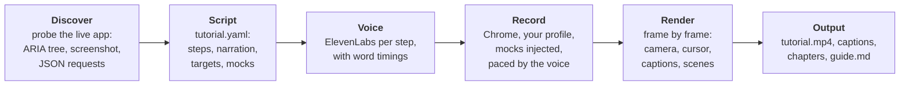

# showhow

Narrated tutorial videos, product trailers and step-by-step guides of any web app, made by an agent from the live app.

You say "make a tutorial of how to invite a teammate in <your app>". The agent explores the app in a real browser, writes a short script (narration + actions), swaps private data for mock data, and `showhow` turns it into:

- `tutorial.mp4` — 1080p, natural voice (ElevenLabs), a cursor that clicks on the word, a camera that zooms to the action, word-timed captions, click and key sounds
- `tutorial.srt` / `.vtt`, `chapters.txt`
- `guide.md` with one screenshot per step (Tango/Scribe-style)

Inspired by [/brag](https://github.com/latent-spaces/brag): the same idea of an agent owning the story, but tutorials need accuracy over hype, so the recording is real and the render is deterministic code.

## How it works



- **No source code needed.** Targets are roles and accessible names, read from the live page.
- **Pacing comes from the voice.** Each step lasts as long as its narration; `sync: Settings` makes the cursor land as the narrator says "Settings". Page loads are cut.
- **Mocks before pixels.** Text rewrites (MutationObserver, works across split nodes and re-renders), attribute pins, API response fixtures (`page.route`), blur. Applied to every tab before capture.
- **Synthetic cursor and camera** from the event log, so they're smooth and identical on every render. Highlighted elements are tracked through layout shifts.
- **Music bed** composed by ElevenLabs Music from a prompt (or your file), ducked under the voice; the mix is normalised to -16 LUFS.
- **Chapters** embedded in the MP4, as WebVTT, and as YouTube-ready timestamps.
- **Animated cards and a designed poster**: aurora shader, word-by-word blur-in and springs from [motion.dev](https://motion.dev), the product tilted in 3D. Every frame is a pure function of time, so renders are deterministic.
- **Lifted UI.** `{ lift: …, as: name }` copies a live element (after mocks) with its styles, fonts and images inlined; a `showhow:ui` scene animates it: tilt in, rows on their spoken word, check marks drawn, spotlights.
- **Vertical format.** `format: vertical` renders 1080×1920 and records the app at a narrow portrait viewport, so each page appears in its own mobile layout, never cropped from desktop footage. A vertical spec `extends:` the landscape one, overriding the steps that differ on a small screen; the shared narration is cached across specs.
- **Motion graphics** between recorded steps: built-in `kinetic`, `ui`, `flow` (self-drawing diagrams with live pulses), `stats` (count-ups), `collage` (labelled real panels), `capabilities` and `media` scenes, or your own HTML with GSAP 3 (DrawSVG, MotionPath, SplitText…) on a timeline the render seeks frame by frame. Scenes cue on narration words and schedule their own sounds (curated Kenney CC0 set). `showhow scene <spec> <step>` previews one.
- **The app's look**: probe reads its colours and fonts (embedded) for scenes that should match the product.
- **Backdrops and brands**: eight built-in backdrops (aurora, mesh, grid, rays, waves, dots, grain, solid) or a brand's own GLSL shader; light or dark themes, a display font, a palette, and a check that warns about colours outside it. Characters can speak the narration (lip-sync from the voice's word timings), and scenes get motion.dev springs as well as GSAP.
- **Three shapes**: a how-to tutorial, a deep-dive guide (chapters + a rich `guide.md`), or a stakeholder presentation (capabilities, how it fits, state in real numbers).
- **Grounded**: every claim comes from the app, its docs, or facts the person gave (`facts:`, listed as sources in the guide); advice is labelled as a suggestion.
- **Web-sized output**: `tutorial.mp4` is compressed (x264 CRF 20, chapters kept); the master stays in `work/`. `--no-compress` to skip.
- **Variants** are small specs that `extends` the original (a translation, a vertical cut): see `examples/wikipedia/wikipedia.es.yaml` and `examples/mossbit/mossbit.vertical.yaml`.

## Install

**Claude Code** (plugin):

```
/plugin marketplace add cberd1509/showhow
/plugin install showhow@showhow
```

Then ask: *"/showhow make a tutorial of how to create a project in https://app.example.com"*. On first use the agent runs `npm install` in the plugin folder.

**Voice (optional).** For natural narration and generated music, add an [ElevenLabs](https://elevenlabs.io) key ([get one](https://elevenlabs.io/app/settings/api-keys)). Run this **in your own terminal**, not in the agent's chat, so the key never enters the conversation; the agent gives you the exact path:

```bash
node <showhow folder>/bin/showhow.js key      # asks for the key (hidden), checks it, saves it
```

It's saved to `~/.config/showhow/.env` (readable only by you), which survives plugin updates. An `ELEVENLABS_API_KEY` environment variable also works and takes precedence. Narration uses Eleven v3 and ElevenLabs' featured voices by default; ElevenLabs bills per character, and narration is cached so re-runs and vertical cuts cost nothing.

**Codex**: the repo ships `.codex-plugin/plugin.json`; install it as a plugin from this repo. **Other agents** (Cursor, Gemini, Aider…): see [docs/other-agents.md](docs/other-agents.md).

**As a CLI**, without an agent:

```bash
git clone https://github.com/cberd1509/showhow && cd showhow && npm install
node bin/showhow.js key   # optional: your ElevenLabs key, for natural voice and music

node bin/showhow.js login --profile myapp https://app.example.com     # sign in by hand, close the window
node bin/showhow.js probe examples/smoke/smoke.yaml                   # what's on screen
node bin/showhow.js make examples/smoke/smoke.yaml                    # voice + record + render
```

`examples/smoke` records the Playwright docs in about 180 characters of narration. The spec format and the whole agent workflow are in [`skills/showhow/SKILL.md`](skills/showhow/SKILL.md).

## Requirements

Node 23.6+ (runs TypeScript directly), Google Chrome, ffmpeg, and an ElevenLabs key (`showhow key`) for narration and music.

## Privacy

Recordings run in your own browser profile (`.profiles/`, git-ignored), signed in by you; the agent never types passwords. The skill's default is to mock anything private (names, emails, customer data) before it reaches a frame, and to never click irreversible actions (pay, delete, send, allow) unless you say so for that run. Outputs land in `showhow-output/` next to the spec (git-ignored): check them before you share them.

## Not yet

- Desktop apps and OS dialogs (planned: macOS accessibility driver + ScreenCaptureKit capture, same event log)
- DOM recording (rrweb) as an alternative capture for re-renderable, editable recordings
- Re-voicing without re-recording (hold frames to fit longer narration)

## Credits

## Acknowledgements

showhow owes its starting point to **[/brag](https://github.com/latent-spaces/brag)** by Shunit Haviv Hakimi (Latent Spaces, MIT): an agent that turns what you built into a polished, shareable video. Its storytelling and motion rules (show the real thing, be specific, keep it readable, make it alive) shaped the skill, which quotes them, and its curated sound set is where the sound effects here were picked from. showhow is a separate implementation: it contains no code from /brag. Motion guidance in the skill also draws on [HyperFrames](https://hyperframes.heygen.com/)' docs.

## Credits

Sound effects: [Kenney](https://kenney.nl) and unicae_games, all CC0; see [assets/CREDITS.md](assets/CREDITS.md). Built on [Playwright](https://playwright.dev), [GSAP](https://gsap.com) and [Motion](https://motion.dev), installed from npm under their own licenses. Voice and music: [ElevenLabs](https://elevenlabs.io) (your key, your account).

## License

MIT
